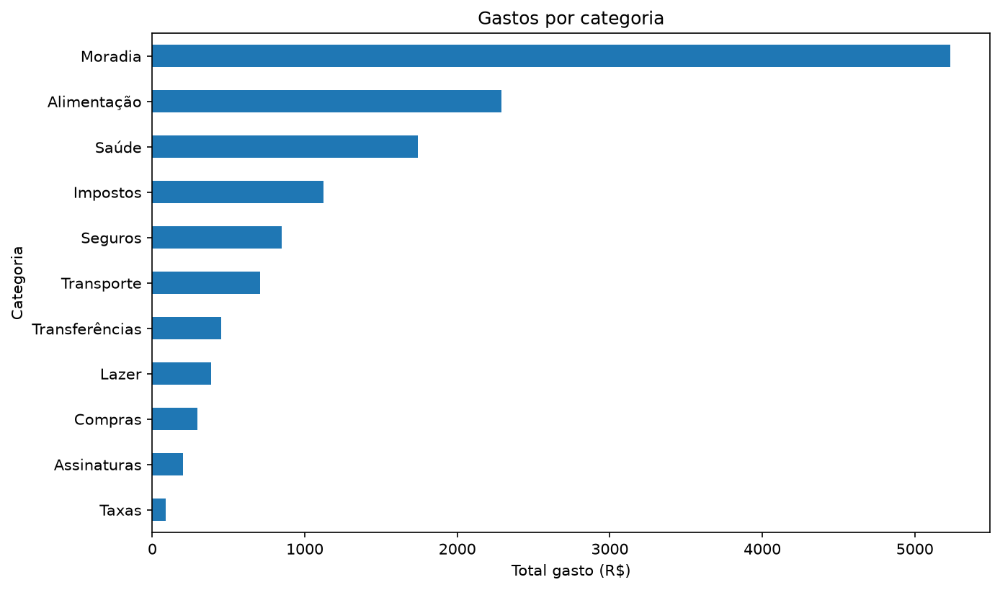
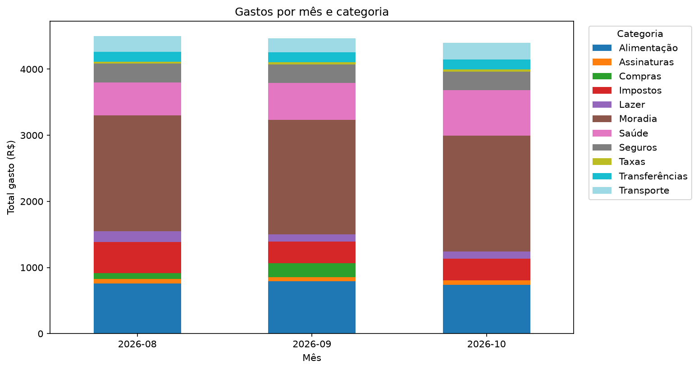

# analisador-gastos

[](https://github.com/KAUAN-KAWASAKI/analisador-gastos/actions/workflows/testes.yml)

Analisador de gastos pessoais em Python. Lê o extrato do banco em CSV, classifica cada lançamento em uma categoria, resume os gastos por mês e por categoria e gera gráficos em PNG.

## Gráficos





## Como rodar

```powershell
python -m venv .venv
.venv\Scripts\activate
pip install -r requirements.txt
python src/grafico.py
pytest
```

No Linux ou macOS, a ativação é `source .venv/bin/activate`. O `python src/grafico.py` lê `dados/exemplo.csv` e salva as imagens na pasta `img/`.

## Como funciona

- `src/leitor.py`: lê o CSV com o Pandas, converte a coluna `data` para data e cria a coluna `mes`.
- `src/categorias.py`: associa cada descrição a uma categoria por palavras-chave. O que não casa com nenhuma fica em "Outros".
- `src/analise.py`: soma só os gastos (valores negativos) por mês, por categoria e por mês e categoria juntos.
- `src/grafico.py`: desenha os dois gráficos com o Matplotlib e salva em PNG.

## Estrutura

```
dados/    CSV de exemplo
img/      gráficos gerados
src/      código
tests/    testes com pytest
```

## Privacidade

O extrato real não vai para o Git: o `.gitignore` ignora tudo em `dados/`, menos o `exemplo.csv`. Esse arquivo é inventado e não tem dados de ninguém.

## O que aprendi

Usei o Pandas para ler, filtrar e agrupar dados com `groupby` e `unstack`. Também aprendi a escrever testes com pytest, usando um DataFrame pequeno montado à mão em vez do CSV.
